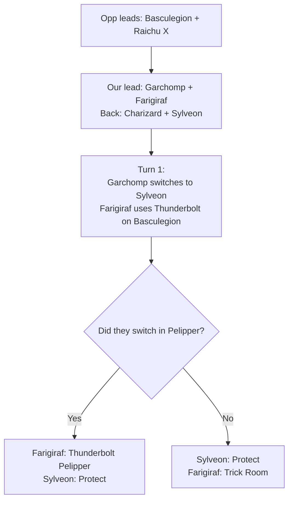

This post is to practise writing and posting these blog-like logs. It's also to try log and get down my current knowledge of Pokemon VGC and my current understanding of the game with the current team I've been using for a month or so now.

To get this out the way, let's go through the line against Louis Fontvielle's regional-winning rain team:

